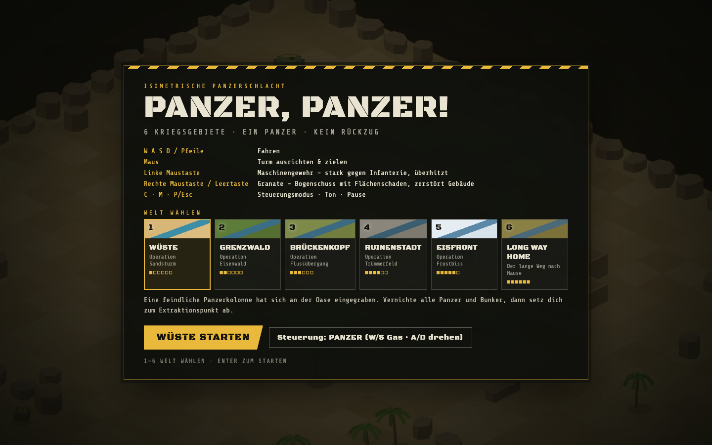
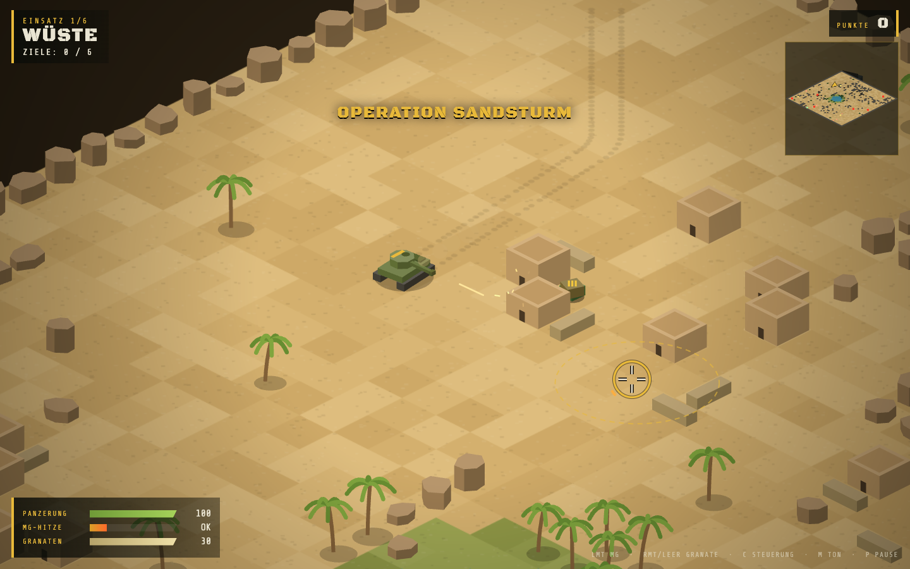
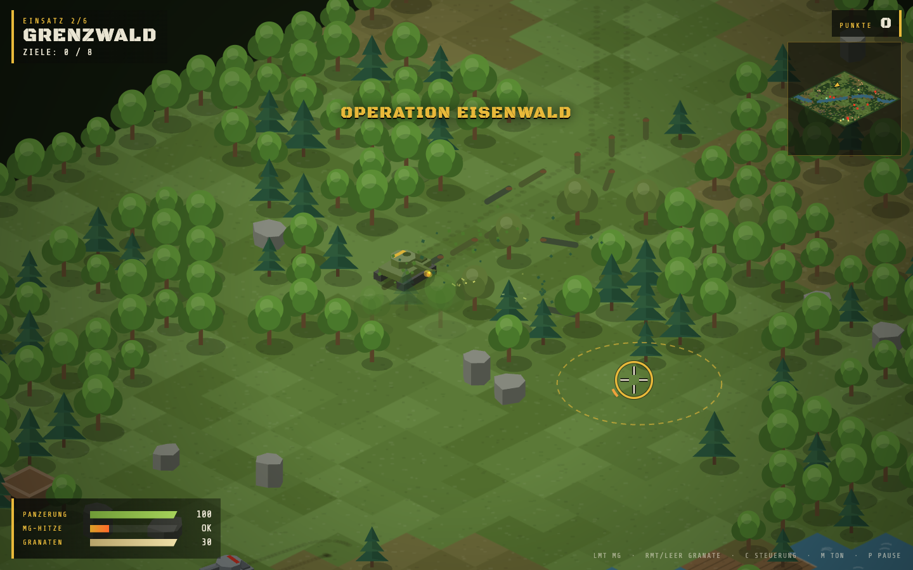
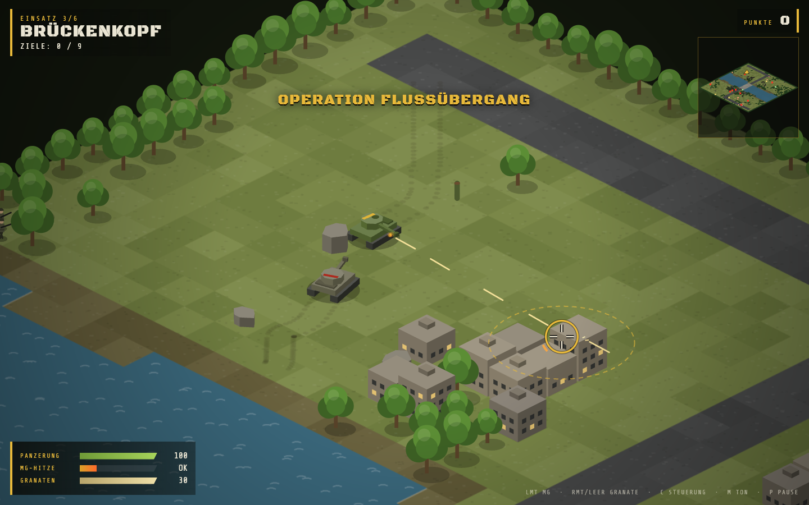
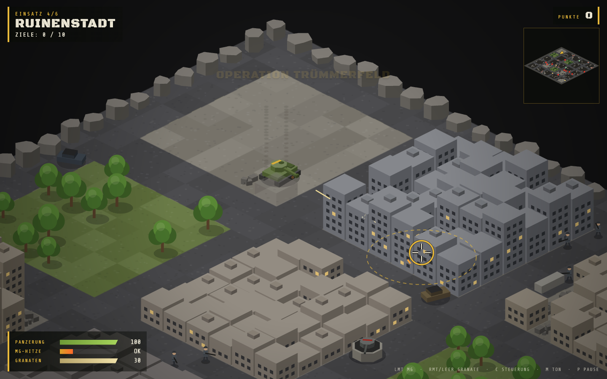
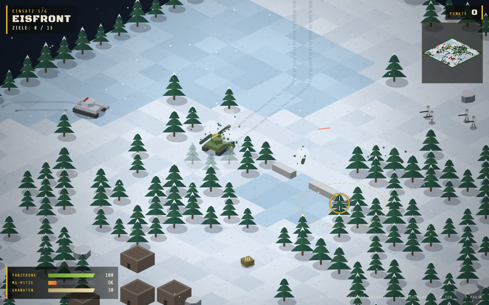
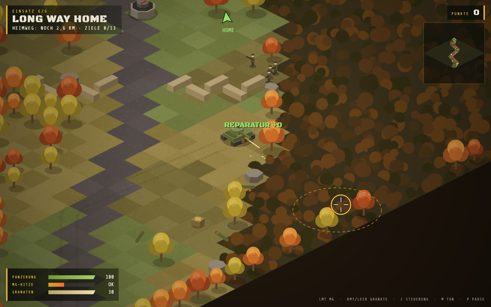
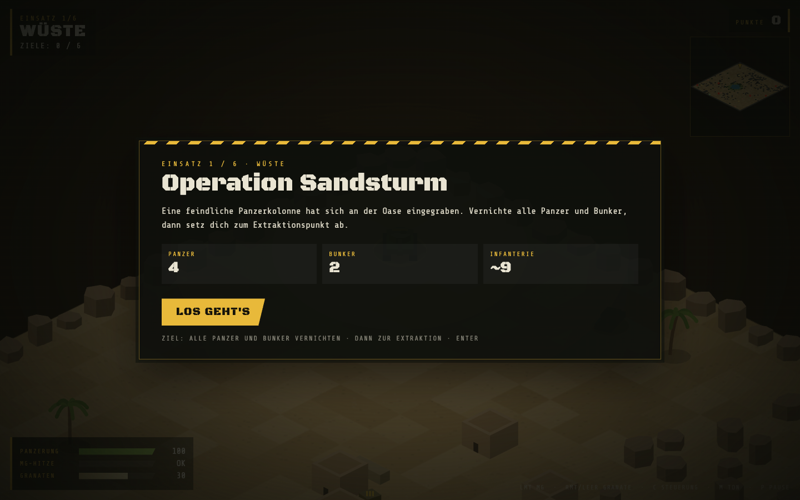

# Panzer, Panzer!

**Isometrische Panzerschlacht im Browser.** Sechs Kriegsgebiete, ein Panzer, kein Rückzug.
Reines HTML5-Canvas und Vanilla-JavaScript, ohne Build-Schritt und ohne Abhängigkeiten.



## Spielen

Klonen und `index.html` im Browser öffnen. Wer lieber einen lokalen Server nutzt:

```sh
python3 -m http.server 8000
# dann http://localhost:8000 öffnen
```

Fortschritt, Bestwert, gewählte Welt und Steuerungsmodus speichert das Spiel im `localStorage`.

## Steuerung

| Taste | Aktion |
|---|---|
| **W A S D** / Pfeiltasten | Fahren |
| **Maus** | Turm ausrichten und zielen |
| **Linke Maustaste** | Maschinengewehr: stark gegen Infanterie, überhitzt bei Dauerfeuer |
| **Rechte Maustaste** / **Leertaste** | Granate: Bogenschuss mit Flächenschaden, zerstört Gebäude |
| **C** | Steuerungsmodus wechseln |
| **M** | Ton an/aus |
| **P** / **Esc** | Pause |
| **1–6**, **← / →** | Welt im Menü wählen |
| **Enter** | Starten / Weiter |

**Steuerungsmodi:**
- **Panzer:** W/S geben Gas, A/D drehen die Wanne.
- **Direkt:** WASD fahren in Bildschirmrichtung.

## Einsatzgebiete

Pro Einsatz vernichtest du alle feindlichen Panzer und Bunker und fährst danach zum Extraktionspunkt.
Unterwegs liegen Reparatur- und Munitionskisten. Der Zeitbonus steigt, je schneller du bist und je mehr Panzerung übrig bleibt.

| # | Gebiet | Operation | Panzer | Bunker |
|---|---|---|---|---|
| 1 | Wüste | Sandsturm | 4 | 2 |
| 2 | Grenzwald | Eisenwald | 5 | 3 |
| 3 | Brückenkopf | Flussübergang | 5 | 4 |
| 4 | Ruinenstadt | Trümmerfeld | 6 | 4 |
| 5 | Eisfront | Frostbiss | 8 | 5 |
| 6 | Long Way Home | Der lange Weg nach Hause | 8 | 5 |

### Wüste: Operation Sandsturm
Eine feindliche Panzerkolonne hat sich an der Oase eingegraben.



### Grenzwald: Operation Eisenwald
Der Gegner hält die Brücken über den Grenzfluss. Bäume kann der Panzer einfach umfahren.



### Brückenkopf: Operation Flussübergang
Die letzte intakte Brücke ist in Feindeshand. Am anderen Ufer warten Bunker und Sandsackstellungen.



### Ruinenstadt: Operation Trümmerfeld
Häuserkampf in Straßenschluchten. Granaten bringen Gebäude zum Einsturz.



### Eisfront: Operation Frostbiss
Die letzte Verteidigungslinie im ewigen Eis, gesichert mit schweren Bunkern.



### Long Way Home: Der lange Weg nach Hause
Eine lange Straße nach Norden durch feindliches Gebiet. Durchbrich jede Straßensperre und komm nach Hause. Abschüsse sind optional, es zählt nur das Ankommen.



## Missionsbriefing



## Projektstruktur

```
index.html     Markup, HUD und Overlay
style.css      Styles für HUD und Menüs
game.js        Spiellogik, Levelgenerierung, Rendering, Sound
screenshots/   Bilder für dieses README
```
